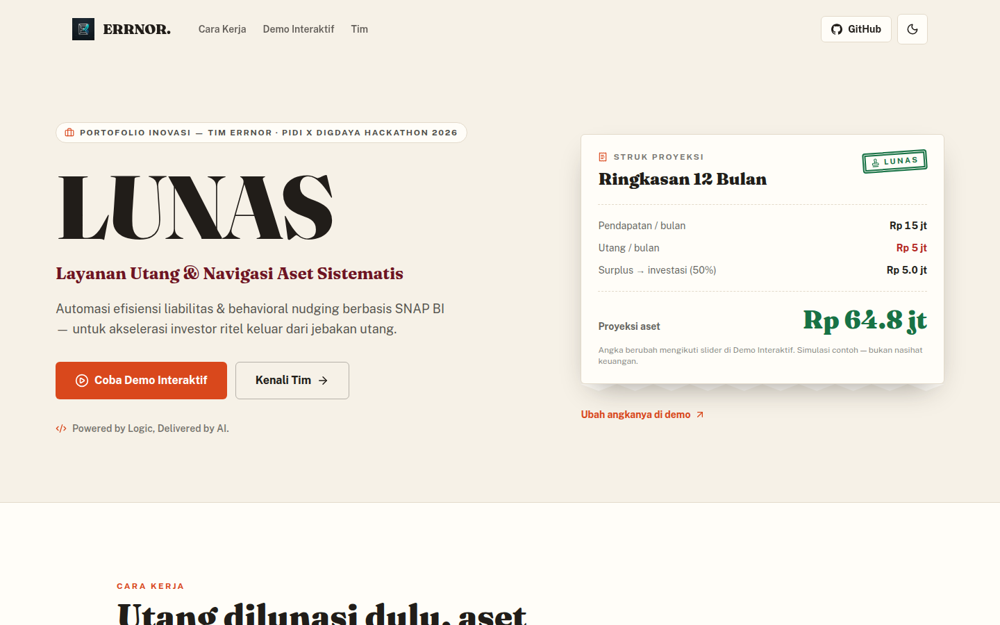
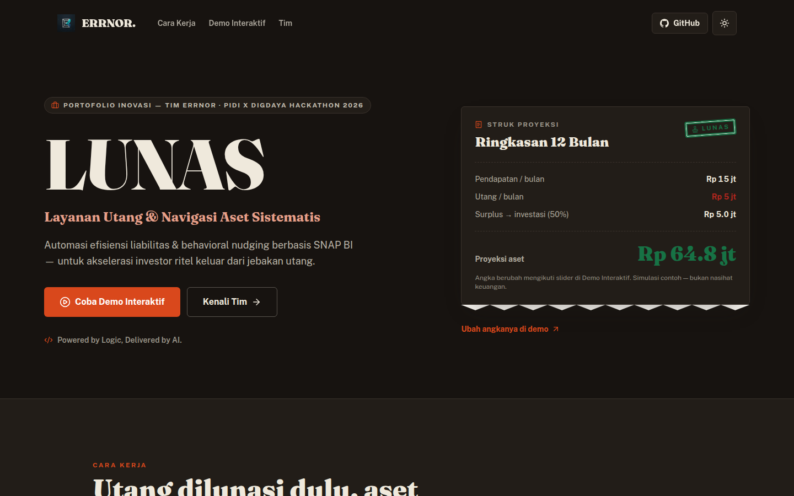
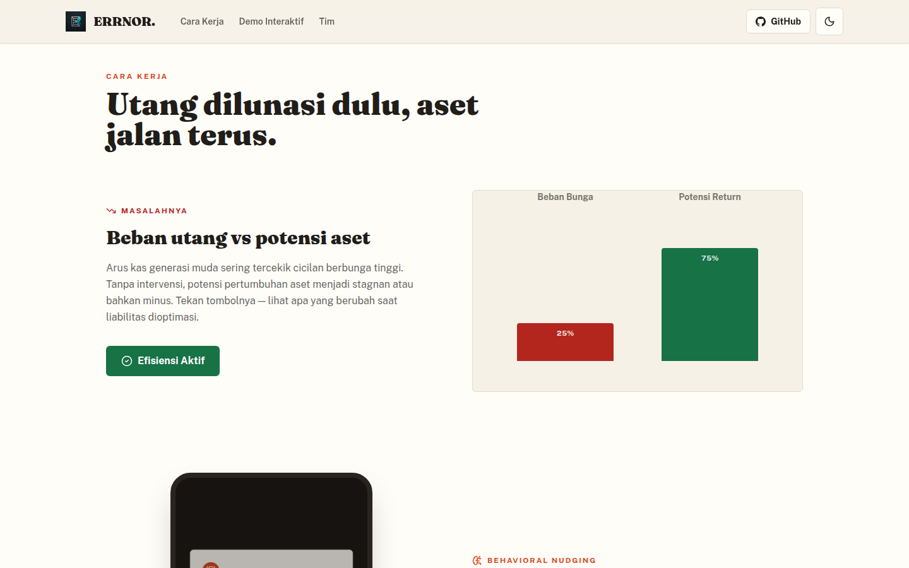
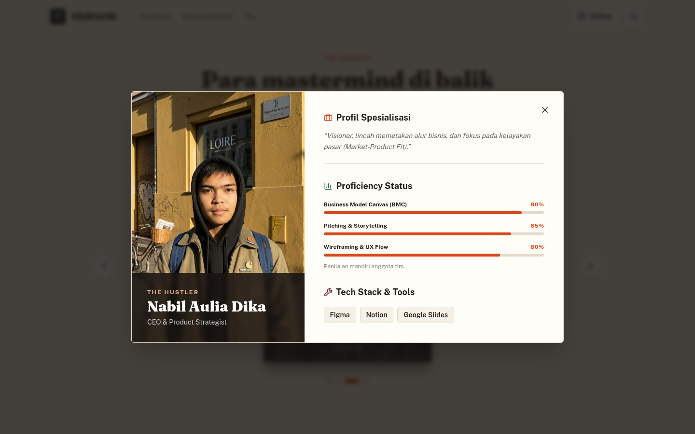
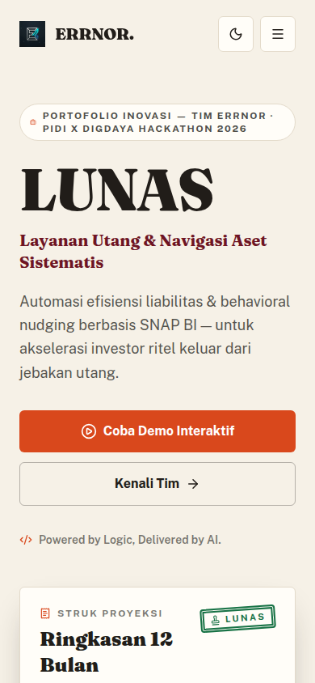
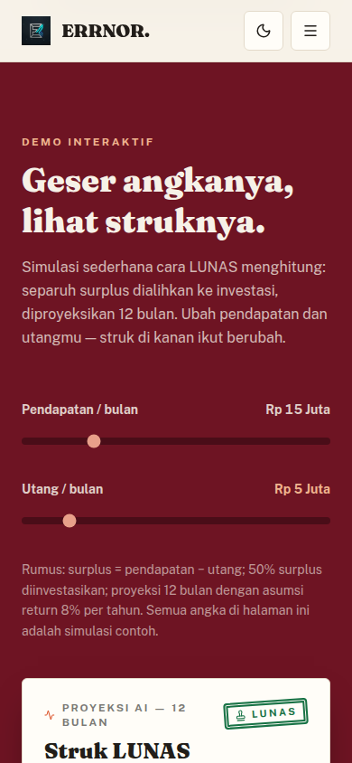

# Team ERRNOR — LUNAS


Portfolio resmi tim **ERRNOR** + showcase produk **LUNAS** — Layanan Utang &
Navigasi Aset Sistematis — untuk **PIDI x Digdaya Hackathon 2026**.

🌍 **Live:** https://errnor-team-portfolio.pages.dev/



## LUNAS itu apa

Platform automasi efisiensi liabilitas & *behavioral nudging* berbasis
SNAP BI untuk akselerasi investor ritel. Idenya sederhana: saat gaji masuk,
AI mencegat sebelum uang habis untuk hal konsumtif — lunasi utang berbunga
tinggi dulu, sisanya masuk investasi. Semua simulasi di situs ini berjalan
sepenuhnya di browser (tanpa backend, tanpa akun).

## Yang bisa dicoba langsung di situs live

| Fitur | Cara mencoba |
|-------|--------------|
| **Kartu struk hidup** | Angka proyeksi di hero mengikuti slider demo |
| **Toggle efisiensi liabilitas** | Seksi Cara Kerja — batang Beban Bunga 85% → 25%, Potensi Return 15% → 75% |
| **Nudge gaji masuk** | Seksi Cara Kerja — ketuk "Ketuk untuk Eksekusi" di mockup ponsel |
| **Demo interaktif** | Geser slider pendapatan/utang — struk proyeksi 12 bulan ikut berubah; utang ≥ pendapatan menampilkan pesan defisit |
| **Carousel tim** | Klik kartu kiri/kanan, panah, atau dot — lalu klik kartu tengah untuk modal detail anggota |
| **Mode gelap** | Toggle di navbar (tersimpan di `localStorage`) |
| **Menu mobile** | Hamburger di layar ≤ 768px membuka panel navigasi |

Semua angka adalah **simulasi contoh** (bukan nasihat keuangan) dan
persentase skill di modal tim adalah **penilaian mandiri anggota tim** —
keduanya dilabeli jujur di UI. Rumus simulasi: lihat
[`docs/data.md`](docs/data.md).

## Tim

| Anggota | Peran | Posisi |
|---------|-------|--------|
| Nabil Aulia Dika | The Hustler | CEO & Product Strategist |
| Arienal Zaky Irvan | The Brain | AI Engineer & Tech Writer |
| Ibnul Jawzy | The Engine | Backend & Cloud Architect |
| Muhammad Rizki | The Face | Frontend & Mobile Dev |

## Tampilan

| Hero | Demo interaktif (mode gelap) |
|------|------------------------------|
|  |  |

| Cara kerja | Modal anggota tim |
|------------|-------------------|
|  |  |

| Mobile 390px | Playground mobile |
|--------------|-------------------|
|  |  |

## Video demo

🎬 [`docs/demo/demo.mp4`](docs/demo/demo.mp4) — 40 detik, 8 adegan:
landing, cara kerja, playground, tim, modal anggota, mobile, mode gelap.

## Desain

Rebuild total 19 Nov 2026 mengikuti standar anti AI slop
([`docs/DESIGN.md`](docs/DESIGN.md)): referensi pemenang **WE-G (Framer)**
— https://www.framer.com/marketplace/templates/we-g/ — kanvas kertas +
oxblood + ember, layout buku kas editorial, detail khas **struk sobek +
stempel LUNAS**. Gate 7 sumbu: anti-slop 5, UX 4, tipografi 5, spacing 4,
motion 4, a11y 4, mobile 4. Tes siluet lolos
([`docs/screenshots/09-silhouette.png`](docs/screenshots/09-silhouette.png)).

## Menjalankan lokal

```bash
npm ci
npm run dev        # http://localhost:5173
npm run build      # output dist/
npm run preview    # sajikan build produksi di 127.0.0.1:4173
```

## Pengujian

```bash
npm run validate   # referensi lokal + alt + secret + gate anti-slop P0
npm run sweep      # OSV advisory sweep (dependensi produksi saja)
npm test           # Playwright e2e — 6 tes (butuh Chromium; lokal pakai
                   # PLAYWRIGHT_CHROMIUM_EXECUTABLE_PATH, jangan
                   # `npx playwright install` di VM ini)
npm run screenshots # 8 screenshot dokumentasi (puppeteer-core + Chromium cache)
npm run make-video  # rangkai screenshot -> docs/demo/demo.mp4
```

Detail pengujian: [`docs/testing.md`](docs/testing.md).

## Dokumentasi

- [`docs/PRD.md`](docs/PRD.md) — persyaratan produk (FR-1–FR-7)
- [`docs/DESIGN.md`](docs/DESIGN.md) — kontrak arah desain + referensi + gate 7 sumbu
- [`docs/architecture.md`](docs/architecture.md) — arsitektur & struktur file
- [`docs/data.md`](docs/data.md) — asal tiap angka + rumus simulasi
- [`docs/diagrams.html`](docs/diagrams.html) — diagram arsitektur, alur data, state carousel
- [`docs/deploy.md`](docs/deploy.md) — deploy Cloudflare Pages + verifikasi

## Teknologi

Vite 6 · React 19 · Tailwind CSS 3 · Lucide Icons · Playwright (e2e) ·
Cloudflare Pages.

## Lisensi

MIT — lihat [`LICENSE`](LICENSE). © 2026 Team ERRNOR.
